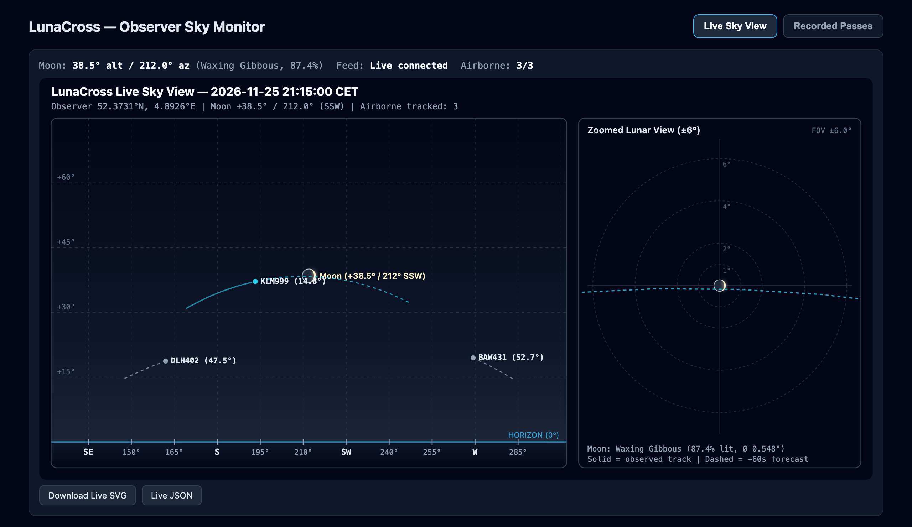
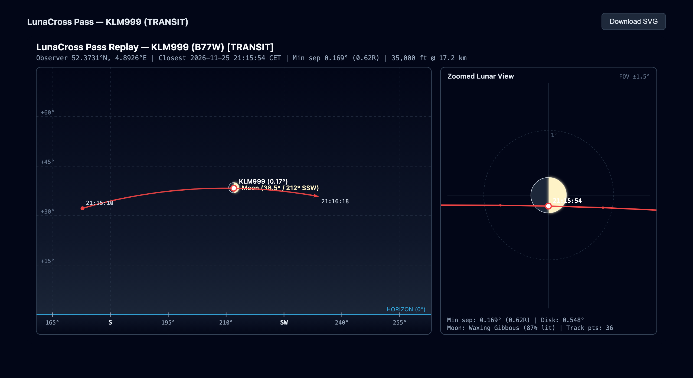

# LunaCross

A Python tool that computes the exact apparent position of the Moon from your location (WGS-84) and monitors live ADS-B aircraft from a local receiver (`readsb` / `tar1090` / `ultrafeeder`) to detect and predict **lunar transits** (aircraft crossing in front of the lunar disk).

## Features

- **High-precision lunar position (`skyfield` + JPL `de421.bsp`)**: topocentric altitude (including atmospheric refraction), azimuth + compass direction, distance in km, exact apparent angular diameter, illumination percentage, lunar phase, and next moonrise/moonset.
- **Local ADS-B receiver integration**: reads live `/data/aircraft.json` from a local `tar1090`/`readsb` feed and can optionally sync coordinates from `/data/receiver.json` (`--sync-receiver`), plus an optional **Hybrid ADS-B mode** combining your local receiver with a free community radius API (`adsb.lol`) for extended coverage and aircraft type/registration enrichment.
- **3D WGS-84 line-of-sight geometry**: transforms aircraft positions (`lat`, `lon`, `alt_geom` / `alt_baro`) via ECEF → local ENU into exact apparent viewing angles (azimuth & altitude) with altitude-scaled refraction and `seen_pos` dead-reckoning.
- **Lookahead trajectory prediction & sub-second detection**: projects flight paths ahead along a great circle to warn of upcoming crossings (`INCOMING`) while interpolating between 1-second ADS-B polls so fast aircraft never slip across the lunar disk undetected.
- **Complete close-pass track recording**: every aircraft entering `log_margin_deg` (default `5.0°`) is recorded with its full topocentric sky track (`passes.jsonl`) and true closest approach.
- **Observer-perspective visualization & Web UI**: generates dark-mode SVG/HTML charts showing your horizon, compass bearings, Moon phase, and aircraft trajectory (both real-time and post-hoc replay), served via an optional built-in Web UI (`web_port = 8091`) or `lunacross render`.
- **Alerts & logging**: live terminal dashboard (`rich`), JSONL logs (`transits.jsonl` & `passes.jsonl`), Pushover push notifications (including a direct link to `tar1090`), macOS Notification Center alerts, and optional webhook support.

## UI Preview

### Live Sky View
*Example using demo coordinates (`52.3731° N, 4.8926° E`): real-time observer horizon, Moon phase, solid observed tracks, and 60s dashed flight path predictions.*



### Pass Replay
*Post-hoc visualization of a simulated lunar transit (`KLM999`), showing both the wide horizon perspective and the zoomed lunar inset.*



## Installation

```bash
git clone https://github.com/wvzuilen/lunacross.git
cd lunacross
uv sync
```

## Configuration

Copy `config.example.toml` to `config.toml` (gitignored) and set your own observer location and ADS-B feed URL:

```bash
cp config.example.toml config.toml
```

Settings are resolved in the following order (lowest to highest priority):
1. Built-in defaults,
2. `config.toml` (auto-loaded from the current working directory, or specified via `--config`),
3. Environment variables (`LUNACROSS_LATITUDE`, `LUNACROSS_LONGITUDE`, `LUNACROSS_ADSB_URL`, `LUNACROSS_WEBHOOK_URL`, ...),
4. CLI flags (`--lat`, `--lon`, `--elevation`, `--url`, `--margin`, `--horizon`, `--sync-receiver`).

### Hybrid ADS-B Mode (Optional)
If your indoor antenna only picks up nearby aircraft, you can combine your local `readsb`/`tar1090` feed with the free community `adsb.lol` radius API (`supplement_url`) to extend coverage and enrich local aircraft with registration and aircraft type metadata:

```toml
supplement_url = "https://api.adsb.lol/v2/lat/{lat}/lon/{lon}/dist/{dist_nm}"
supplement_radius_nm = 45.0
supplement_interval_s = 5.0
```

## Usage

```bash
# 1. Show the current Moon position for your location
uv run lunacross moon

# 2. One-shot check: Moon position + live aircraft
uv run lunacross check

# 3. Start the live monitoring dashboard (polls every second)
uv run lunacross monitor

# 4. Run a simulation to verify prediction & transit detection
uv run lunacross simulate
```

Useful global options (placed before the subcommand):

```bash
uv run lunacross --sync-receiver check
uv run lunacross --margin 0.8 --horizon 180 monitor
uv run lunacross --config config.toml monitor
```

## Pushover Notifications

Receive instant Pushover alerts when an aircraft is on course to cross the Moon (`INCOMING`, up to 120s ahead) and/or while it is crossing (`TRANSIT`), complete with a clickable link to that aircraft on your local `tar1090` radar.

1. Set `pushover_app_token` and `pushover_user_key` in `config.toml` (or via `LUNACROSS_PUSHOVER_APP_TOKEN` and `LUNACROSS_PUSHOVER_USER_KEY`).
2. Test delivery:
   ```bash
   uv run lunacross test-pushover
   ```
3. Or send simulated transit alerts to your device:
   ```bash
   uv run lunacross simulate --pushover
   ```

## Sky Visualization & Web UI

Generate an observer-perspective sky chart (horizon, compass ticks, Moon phase, aircraft path, and zoomed lunar inset) directly from the CLI:

```bash
# List all recorded close passes
uv run lunacross render --list

# Render the latest recorded pass (or pass --pass-id <id>) to an interactive HTML or SVG file
uv run lunacross render -o pass.html

# Render the current live sky + 60s predicted flight paths
uv run lunacross render --live -o live_sky.html

# Simulate a lunar transit and render its sky chart
uv run lunacross simulate --render sim_transit.html
```

To enable the built-in real-time Web UI (with auto-refreshing **Live Sky View** and **Recorded Passes** replay), set `web_port = 8091` in `config.toml` (or pass `--web-port 8091`), then open `http://<server-ip>:8091`.

## Docker (24/7 Server Deployment)

1. Create `config.toml` from `config.example.toml` and set the container paths:
   ```toml
   log_file = "/data/transits.jsonl"
   passes_file = "/data/passes.jsonl"
   ephemeris_dir = "/data/skyfield"
   notify_macos = false
   web_port = 8091
   ```
2. Build and start the container (`restart: unless-stopped`):
   ```bash
   docker compose up -d --build
   ```
3. Follow the live logs:
   ```bash
   docker logs -f lunacross
   ```

## Running Tests

```bash
uv run pytest -v
```
